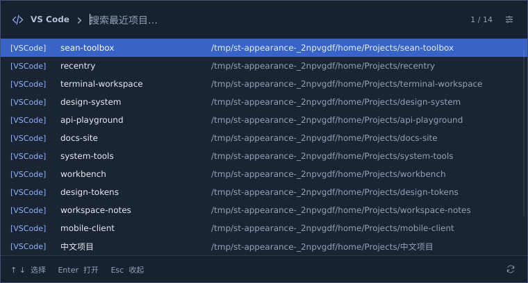
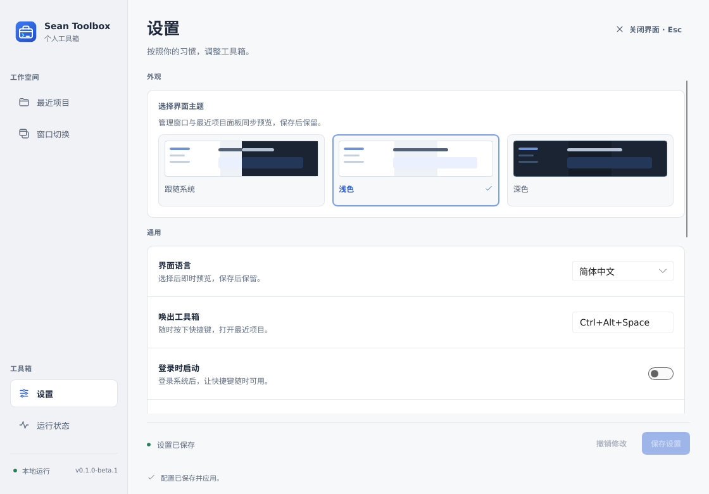
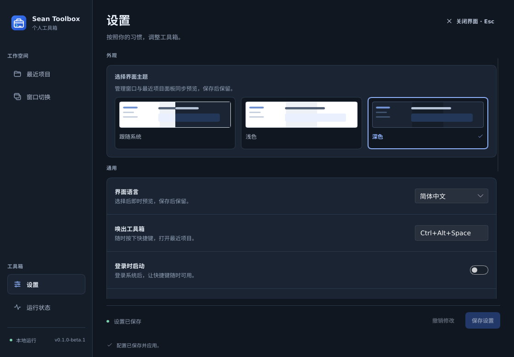

# Sean Toolbox · 个人工具箱

一个独立的跨平台桌面工具箱，使用 **Rust + Slint**。首批功能是应用窗口快捷键和 VS Code 最近项目搜索，逐步把日常需要的小工具放进同一个应用。

不需要 uTools、AutoHotkey 或 Node.js 运行环境。当前版本为 **0.1.0-beta.1**，Windows 优先；macOS 和 Linux 使用各自的原生后端。

[](https://slint.dev)

## 界面预览



快捷键唤出独立的紧凑搜索面板，按名称或路径快速回到最近项目。
应用配置与设置使用完整管理窗口，保留左侧导航和独立编辑区。

| 浅色主题 | 深色主题 |
| --- | --- |
|  |  |

更多界面：[管理窗口中的项目页](docs/images/projects.png) · [应用编辑](docs/images/window-editor.png) · [Quake 停靠编辑器](docs/images/quake-editor.png)。
截图来自真实 Slint 窗口，使用隔离测试配置与示例项目；字体、标题栏及缩放随系统变化。

## 功能

### 应用窗口快捷键

- 应用未运行时按顺序尝试启动候选；某个候选成功启动后，等待窗口出现，不因窗口出现慢而再次启动另一个候选。
- 一个窗口时切换显示和最小化；多个窗口时按稳定顺序循环，末尾全部最小化，再次按下重新开始。
- 可选择切换到其他应用后继续上次的循环位置。
- 可选择只最大化新启动的窗口，保留已有窗口的大小。
- 应用配置可增删改、启停，分别指定平台、进程或应用标识、快捷键、启动程序、独立参数数组和工作目录。
- 启动过程中如果用户主动切到别的窗口，停止自动抢焦点。系统拒绝激活时显示真实错误。

默认示例：WezTerm `F3`、VS Code `F4`、Chrome `F5`。请按实际安装路径调整。Windows 会尝试这些应用的常用安装目录；macOS 使用 `/Applications`；Linux 使用 `PATH`。

### Quake 停靠模式

在应用编辑区开启“Quake 停靠模式”，可把终端、编辑器等常用应用固定为随时唤出的面板。
交互参考 [Windows Terminal Quake](https://github.com/flyingpie/windows-terminal-quake)。

- 同一个快捷键唤回同一个应用窗口；窗口在前台时再按一次收起，其他同应用窗口不参与循环。
- 支持顶部、底部、左侧和右侧停靠，宽高分别设置为显示器可用工作区的 **10–100%**，并可选择起始、居中或末端对齐。
- 支持鼠标所在显示器、前台窗口所在显示器和主显示器。每次显示重新计算位置，使用工作区避开任务栏或 Dock。
- 编辑区实时预览布局，提供“顶部半屏”“右侧边栏”“铺满工作区”预设；尺寸与位置在下一次唤起时应用。
- Windows / X11 可选“显示时保持置顶”。收起、停用、重新配置或退出宿主时恢复窗口原本的置顶状态。
- Windows 可选“失去焦点时自动收起”，通过系统焦点事件触发；所属对话框获得焦点时保持显示。没有全局 Esc 拦截，终端和编辑器仍可正常使用 Esc。
- 旧配置默认关闭 Quake 模式，继续使用原有多窗口循环。停靠模式不使用“仅新启动窗口最大化”和“继续循环”选项。

macOS 支持通过辅助功能定位窗口，暂不支持外部应用置顶与失焦自动收起；Linux 需要 X11 / EWMH，显示器发现优先使用 RandR，Wayland 外部窗口控制仍不支持。
目标应用的最小尺寸、终端字符网格和操作系统焦点策略可能影响最终大小与激活结果。平台实现细节见 [窗口模块说明](crates/toolbox-windows/README.md)。

### 最近项目

- 读取 **VS Code Stable** 标准用户目录中的历史记录，保留本地文件夹、`.code-workspace` 和远程 URI 的不同含义。
- 快捷键面板参考 [Recentry](https://github.com/sean2077/recentry)：无系统标题栏、置顶，默认 760×408 逻辑像素，每行显示项目名称与路径，悬停查看完整路径，右侧显示“当前选择 / 匹配数量”；超过可见行数可滚动。
- 每次唤起重新读取历史、清空搜索并聚焦输入；空搜索保留最近访问顺序，输入后按名称和路径模糊匹配。
- `↑` / `↓` 选择（到首尾停止）、`Enter` 或双击打开，单击只选择；`Esc` 或切到其他窗口时收起。打开成功后收起，失败时保留面板并显示错误。
- 面板内 `Ctrl+K` / `Ctrl+F` 聚焦并全选搜索，`Ctrl+R` 刷新，`Ctrl+,` 或右上角设置按钮打开管理窗口（macOS 也支持 `⌘`）。已有快捷键配置保持不变。
- 管理窗口仍有完整项目页，`Ctrl+K` / `Ctrl+F` 可回到该页；无历史、无匹配、模块停用和读取失败分别提示下一步。
- 唤出、使用或收起项目面板不会丢弃管理窗口中的应用和设置草稿；较早的打开请求完成后不会收起后来重新唤出的面板。
- 数据库按只读方式打开，不修改 VS Code 状态。
- 只读取最近项目，不扫描全盘，不收集普通最近文件。
- 可指定 VS Code 可执行文件路径。打开请求直接传递参数，不拼接 shell 命令。

### 工具箱本身

- 默认 `Ctrl+Alt+Space` 唤出独立项目面板，也可从托盘打开项目面板、应用配置、设置和运行状态。
- 中文默认界面，可切换英文；固定侧边导航、分组设置和独立应用编辑区。设置包含模块启停、开机启动和界面闲置释放时间。
- 支持**跟随系统、浅色、深色**三种主题，管理窗口、最近项目面板和表单控件同步即时预览；保存后生效，撤销可恢复原主题。
- 使用统一应用图标，包括窗口、托盘、Windows EXE、macOS 应用包和 Linux 桌面入口；macOS 菜单栏使用随系统外观着色的模板图标。
- 应用和设置各自保留未保存的修改，导航显示修改标记；可以单独撤销设置。`Ctrl+S`（macOS 也支持 `⌘+S`）保存当前编辑页，`Ctrl+1`–`4` 切换页面。
- INI / JSON 导入有预览，支持合并或替换应用配置；支持 JSON 导出。
- 快捷键冲突不会覆盖当前配置；保存有版本校验和原子文件替换。
- 运行状态页用状态卡片显示窗口控制、快捷键与托盘能力，单独列出最近操作、提示与错误；技术详情可展开，保留关于和第三方来源。

## 平台范围

| 平台 | 窗口控制 | 全局快捷键 | 界面和项目搜索 |
| --- | --- | --- | --- |
| Windows | Win32：进程名、顶层窗口枚举、显示/最小化/最大化 | 原生注册 | Slint 原生界面 |
| macOS | Accessibility API + AppKit；按 bundle ID 匹配，需要辅助功能权限 | 原生注册；可能与系统快捷键冲突 | Slint 原生界面 |
| Linux X11 | X11 / EWMH；按 WM_CLASS 或进程名匹配，需要兼容的窗口管理器 | X11 注册 | Slint 原生界面 |
| Linux Wayland | 本版不支持任意外部窗口控制 | 本版未实现桌面 Portal 全局快捷键 | 项目搜索、设置及支持 StatusNotifierItem 的托盘可用 |

**实现和验证是两件事：** 仓库提供三平台原生构建 CI 和 Linux X11 真窗口测试。Windows/macOS 的焦点策略、权限提示、系统缩放和桌面交互仍需要对应系统实机验收；交叉编译通过不能替代这些检查。

已完成的检查、原生界面验收与资源采样见 [验证记录](docs/VALIDATION.md)。

Windows 普通权限进程无法保证控制管理员权限窗口。macOS 在“系统设置 → 隐私与安全性 → 辅助功能”授权后可在诊断页重新检查；应用路径或签名变化可能需要重新授权。Linux 桌面没有托盘宿主时仍可通过命令行打开界面。

## 获取与运行

在 [Actions](https://github.com/sean2077/sean-toolbox/actions/workflows/ci.yml) 中下载成功构建的对应平台 artifact。版本标签 `v*` 通过全部构建后会生成 [Release](https://github.com/sean2077/sean-toolbox/releases)。每个压缩包包含安装说明和 SHA-256 文件。

- Windows：完整解压后运行 `sean-toolbox.exe`。
- macOS：解压并将 `Sean Toolbox.app` 放到固定位置，再打开应用。
- Linux：解压后运行 `bin/sean-toolbox`；桌面入口安装方法见包内 `INSTALL.md`。

Linux 文件导入/导出对话框需要可用的 XDG Desktop Portal 文件选择后端或 `zenity`；缺少后端时界面会提示错误，项目搜索与快捷键功能可独立使用。

**主程序和 `sean-toolbox-ui` 必须保持在一起。** 首次打开会启动托盘宿主并显示项目面板；最后一个界面关闭后，UI 进程退出并释放其内存，负责全局快捷键和托盘的宿主继续运行。再次唤起会按需启动新的 UI 进程。

新配置的界面缓存默认为 **0 秒**。可在设置中为自动失焦收起、打开项目后的自动收起配置 1–3600 秒缓存，以换取更快的热唤起；已有明确缓存值保持不变。点击系统关闭按钮、界面的“关闭界面”或按 `Esc` 主动关闭最后一个界面时，始终立即释放，不等待缓存计时。可见的另一界面、未保存的草稿、文件对话框和进行中的操作会阻止提前退出；关闭有修改的管理窗口时先确认是否放弃修改。

退出整个应用请使用托盘“退出工具箱”或 `sean-toolbox quit`。

当前构建没有 Windows Authenticode 签名或 macOS Developer ID 签名及公证。下载完成并不代表本机所有桌面权限已就绪，请先检查诊断页。

## 配置

配置位置：

| 系统 | 路径 |
| --- | --- |
| Windows | `%LOCALAPPDATA%\SeanToolbox\config.json` |
| macOS | `~/Library/Application Support/SeanToolbox/config.json` |
| Linux | `$XDG_CONFIG_HOME/sean-toolbox/config.json`，未设置时为 `~/.config/sean-toolbox/config.json` |

推荐使用界面编辑。手动改文件前先退出宿主；无效配置会报错并保留原文件，不会静默重置。配置文件上限 1 MiB，每个应用最多 8 个启动候选。开发和测试可通过绝对路径环境变量 `SEAN_TOOLBOX_CONFIG` 指定配置文件；单实例仍以当前用户为范围。

一个应用配置示例：

```json
{
  "id": "vscode",
  "name": "VS Code",
  "platform": "windows",
  "matcher": "Code.exe",
  "hotkey": "F4",
  "enabled": true,
  "maximize": false,
  "cycle_continuous": true,
  "launch": [
    {
      "executable": "%LOCALAPPDATA%\\Programs\\Microsoft VS Code\\Code.exe",
      "args": ["--new-window"],
      "cwd": null
    }
  ]
}
```

参数填写为 JSON 字符串数组，例如 `["--new-window", "D:\\Work\\My Project"]`。程序路径和工作目录支持 `~`、`%VAR%`、`${VAR}` 展开，参数保持原样。Windows 请指向 `.exe`，不要指向 `code.cmd`；最近项目模块可将受支持布局中的 `code.cmd` 定位到真实的 `Code.exe`。

旧 WinGuake INI 导入会转换常用 AHK 热键表示法，但不会执行 AHK。导入的 Windows 配置保留平台标签，在其他系统上不会自动启用。

全局 `theme` 可设为 `"system"`、`"light"` 或 `"dark"`，省略时跟随系统。单个应用的 `quake` 字段可使用以下对象；省略时保持普通切换模式：

```json
{
  "enabled": true,
  "edge": "top",
  "alignment": "center",
  "width_percent": 100,
  "height_percent": 50,
  "monitor": "cursor",
  "always_on_top": false,
  "hide_on_focus_loss": false
}
```

`edge` 支持 `top` / `bottom` / `left` / `right`；`alignment` 支持 `start` / `center` / `end`；`monitor` 支持 `cursor` / `foreground` / `primary`。启用失焦自动收起需要 Windows，启用置顶需要 Windows 或 X11。旧 JSON 无需手动迁移；导入预览会展示新增设置，合并仍只修改应用配置，完整替换才恢复通用设置。

## 命令行

```text
sean-toolbox                              打开最近项目
sean-toolbox show windows                 打开窗口配置
sean-toolbox show settings                打开设置
sean-toolbox show diagnostics             打开诊断
sean-toolbox --background                 仅启动常驻宿主
sean-toolbox toggle vscode                切换指定应用
sean-toolbox status                       JSON 诊断
sean-toolbox config                       当前配置与修订版本
sean-toolbox config-path                  配置文件位置
sean-toolbox quit                         退出宿主和其界面
```

打开界面的命令可自动启动宿主，`status` / `config` / `toggle` / `quit` 要求宿主已运行。后台启动日志写到配置目录的 `host.log`。

## 开发

工具链固定在 `rust-toolchain.toml`，依赖版本保存在 `Cargo.lock`。需要 Rust、目标平台 C/C++ 链接工具，以及 Linux 的 X11/Wayland、字体和键盘开发库。Ubuntu 的完整依赖安装命令见 [CI](.github/workflows/ci.yml)。

Windows 本地构建使用 MSVC 工具链，仓库 CI 的 Windows 构建也使用 MSVC。如果 rustup 默认 host 是 `x86_64-pc-windows-gnu`，需要完整安装 MinGW-w64（至少提供 `dlltool` 等 binutils），或为本仓库设置与 `rust-toolchain.toml` 同版本的 MSVC override；否则 `windows-strings` 等 crate 的 `raw-dylib` 链接会失败。

```sh
cargo fmt --all -- --check
cargo clippy --locked --workspace --all-targets -- -D warnings
cargo test --locked --workspace
cargo build --locked --release -p toolbox-host -p toolbox-ui
./target/release/sean-toolbox
```

常用操作已封装在仓库根目录的 `Makefile` 中，运行 `make help` 查看全部目标；例如 `make check`（格式 + Clippy + 测试）、`make build-release`、`make run` 和 `make package`。Makefile 假定可用的 POSIX shell，Windows 上请在 Git Bash 中运行。

Linux 真窗口测试使用独立 Xvfb、Openbox 和 xterm，清理由脚本负责：

```sh
bash crates/toolbox-windows/tests/run-x11-smoke.sh
python scripts/smoke_host.py --binary target/release/sean-toolbox
python scripts/smoke_appearance.py --binary target/release/sean-toolbox
```

第二项检查真实快捷键、配置事务、单实例、UI 释放和退出清理；附加 `--measure` 可对当前 Linux 测试环境中的空闲宿主采样 10 秒。测试自动隔离显示服务与用户目录。
第三项验证真实界面的主题保存、窗口图标、预览撤销、关闭释放、快速重唤起，以及 Quake 预设保存后通过快捷键控制真实窗口；可用 `--scale 1.5` 检查 150% 缩放，`--screenshots <目录>` 保存截图（仅截图功能需要 ImageMagick）。

构建完成后收集第三方许可并打包：

```sh
cargo fetch --locked
python scripts/collect_licenses.py
python scripts/package.py
```

### 模块划分

| crate | 责任 |
| --- | --- |
| `toolbox-core` | 配置模型、校验、原子存储、INI 导入、IPC 协议 |
| `toolbox-ipc` | 当前用户的本地 socket / named pipe，消息大小与等待时间限制 |
| `toolbox-windows` | 窗口状态机与 Win32 / AX / X11 适配；这里的 windows 指应用窗口 |
| `toolbox-projects` | VS Code 数据源、项目身份、排序和打开策略 |
| `toolbox-host` | 单实例、快捷键、托盘、配置事务、窗口 worker、界面生命周期 |
| `toolbox-ui` | Slint 项目面板与四页管理窗口、交互状态、按需项目查询和文件选择 |

常驻宿主不链接 Slint、SQLite 或项目索引模块。UI 进程按需启动；窗口控制仅在触发时工作，不持续枚举所有窗口。宿主主事件循环等待事件；系统库和不同桌面的实际资源占用应分别测量，不把一个平台的结果作为所有平台保证。

新增功能优先作为独立 Rust crate，通过明确的命令和数据模型接入宿主或界面。首版使用内置模块，尚无第三方插件 ABI、脚本运行时或插件商店。需要独立安装插件时再选择有版本协议的进程接口，避免提前绑定不稳定的 Rust 动态库 ABI。

## 已知范围

- 最近项目支持 VS Code Stable 的标准用户目录；暂不自动发现 Insiders、便携数据目录、自定义 `--user-data-dir` 和自定义 profile。
- VS Code 已打开项目的判断来自其最后保存的窗口状态，因此只表达打开偏好，不能保证操作系统最终焦点。
- 窗口匹配以应用为单位，不按浏览器标签页、窗口标题正则或虚拟桌面规则匹配。
- 无自动更新、云同步、遥测、远程服务或第三方扩展加载。开机启动默认关闭。
- 两个模块可以分别停用；Wayland 的外部窗口限制会明确显示，不伪装成已支持。

## 来源和许可

应用自有代码采用 [MIT](LICENSE)。项目历史读取及 IPC 源自 [Recentry](https://github.com/sean2077/recentry)，窗口行为和 INI 迁移参考 [WinGuake](https://github.com/sean2077/winguake)，保留其 MIT 许可与来源记录；Quake 停靠与显示器选择交互参考 [Windows Terminal Quake](https://github.com/flyingpie/windows-terminal-quake)，以现有 Rust 原生后端独立实现。

Slint 在本应用中按 Royalty-free Desktop, Mobile, and Web Applications License 2.0 使用，保留界面中的 `AboutSlint` 和本页归属徽章。详见 [第三方说明](THIRD_PARTY_NOTICES.md)；发行包另附依赖许可汇总。
